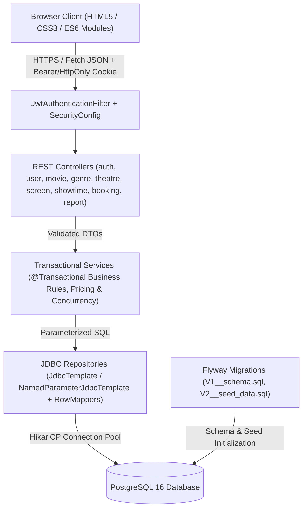
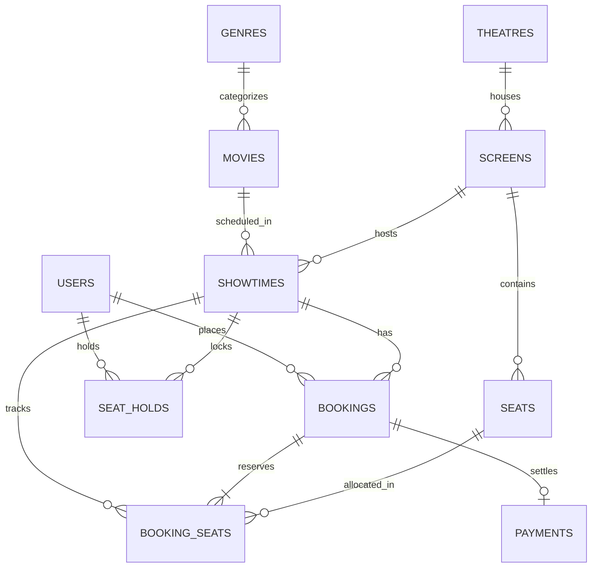
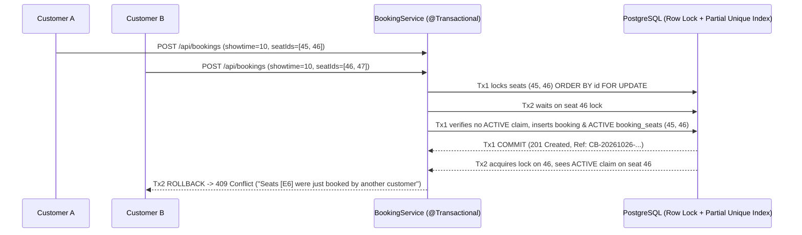

# CineBook — Production-Style Movie Ticket Booking Platform

**CineBook** is a full-stack movie discovery, showtime scheduling, interactive seat reservation, and cinema analytics web application inspired by the user experience of BookMyShow. It is built as a clean modular monolith using **Java 21 LTS**, **Spring Boot 3.5.0**, **Spring Security (JWT + BCrypt)**, **Spring JDBC (`JdbcTemplate` / `NamedParameterJdbcTemplate`)**, **Flyway**, **PostgreSQL**, and a responsive **HTML5 / CSS3 / ES6 Modules** frontend served directly by Spring Boot.

---

## 1. Key Features

### Customer Experience
- **Movie Discovery**: Browse *Now Showing* and *Coming Soon* movies on the landing page, search by title, filter by genre, language, and release status, and sort by popularity, release date, or title.
- **City, Theatre & Showtime Selection**: Switch cities (default **Bengaluru**, plus Mumbai and Hyderabad), compare venues, screens, presentation formats (`IMAX 2D`, `IMAX 3D`, `DOLBY ATMOS`, `3D`, `2D`), and real-time seat availability badges (`AVAILABLE`, `FILLING_FAST`, `SOLD_OUT`).
- **Interactive Auditorium Seat Map**: Visual curved cinema screen, rows `A`–`H` grouped into **Royal Recliner**, **Prime Executive**, and **Classic Regular** tiers, live seat state indicators (`Available`, `Selected`, `Temporarily Held`, `Booked`), and configurable per-order seat cap (`10` seats).
- **Concurrency-Safe Reservation & Server-Side Checkout**: Temporary seat holds (`/api/bookings/holds`), server-calculated ticket subtotal + convenience fee (`8.5%`) + integrated GST (`18%` on fee), duplicate submission prevention via `X-Idempotency-Key`, and clearly labelled **Demo Checkout** confirmation (`PaymentGateway` interface ready for Razorpay/Stripe).
- **E-Ticket & QR Verification**: Printable booking confirmation with a deterministic SVG QR code encoding a non-sensitive verification token (`/api/bookings/verify/{token}`).
- **My Bookings & Atomic Cancellation**: View *Upcoming*, *Past*, and *Cancelled* bookings; cancel eligible upcoming bookings up to 60 minutes before showtime start with immediate seat release and preserved historical audit rows.

### Administrator Console (`/admin/dashboard.html`)
- **Executive Dashboard**: Real PostgreSQL-derived KPIs (total/active movies, active showtimes, confirmed/cancelled bookings, confirmed seats sold, confirmed booking value, and overall scheduled occupancy %).
- **Catalog, Venue & Screen Management**: Full CRUD for Movies (with safe deletion check), Genres, Theatres, and Screens with automated physical seat layout generation (`POST /api/admin/screens/{id}/seats`).
- **Showtime Scheduling with Overlap Protection**: Automatic end-time calculation (`movie.durationMinutes + 25m turnaround buffer`) and transaction-level screen locking (`SELECT ... FOR UPDATE`) to prevent overlapping showtimes on the same screen.
- **SQL Analytics Reports & CSV Export**: Revenue by date range, occupancy per showtime vs. screen capacity, movie performance leaderboard, and one-click CSV download (`/api/admin/reports/export`).

---

## 2. Technology Stack

| Layer | Technology | Version / Details |
| :--- | :--- | :--- |
| **Language & Runtime** | Java LTS | Java 21 (`maven.compiler.release=21`) |
| **Backend Framework** | Spring Boot | `3.5.0` (`spring-boot-starter-web`, `security`, `jdbc`, `validation`, `actuator`) |
| **Database & Access** | PostgreSQL + Spring JDBC | PostgreSQL 15/16, `JdbcTemplate`, `NamedParameterJdbcTemplate`, `RowMapper` |
| **Schema Migrations** | Flyway | `flyway-core`, `flyway-database-postgresql` (`V1__schema.sql`, `V2__seed_data.sql`) |
| **Authentication** | Spring Security + JJWT | `io.jsonwebtoken:jjwt-*:0.12.6`, BCrypt (`strength=10`), `HttpOnly` Cookie + `Bearer` Header |
| **API Documentation** | Springdoc OpenAPI | `springdoc-openapi-starter-webmvc-ui:2.8.6` (Swagger UI) |
| **Frontend** | HTML5, CSS3, ES6 Modules | Native ES Modules, Fetch API, CSS Variables, Responsive Grid, SVG Posters & QR |
| **Testing** | JUnit 5, Mockito, Testcontainers | `spring-boot-starter-test`, `spring-security-test`, `testcontainers:postgresql:1.20.6` |

---

## 3. System Architecture & Diagrams

### 3.1 Modular Monolith Architecture



### 3.2 Database Entity-Relationship (ER) Diagram



### 3.3 Concurrency-Safe Seat Booking Workflow & Double-Booking Prevention

CineBook uses a **two-layer database concurrency defense** inside `BookingService.createBooking(...)` (`@Transactional(isolation = Isolation.READ_COMMITTED)`):

1. **Deterministic Pessimistic Row Locking (`SELECT ... FOR UPDATE`)**:
   - Before checking seat availability, requested `seatIds` are deduplicated and sorted in ascending numerical order (`sortedSeatIds`).
   - `SeatRepository.findAndLockSeatsForScreen(screenId, sortedSeatIds)` executes:
     ```sql
     SELECT id, screen_id, row_label, seat_number, seat_type, is_active
     FROM seats
     WHERE screen_id = :screenId AND id IN (:seatIds)
     ORDER BY id ASC
     FOR UPDATE
     ```
   - Locking physical `seats` rows in ascending ID order serializes any two concurrent transactions attempting to book overlapping seats on the same screen and eliminates deadlock cycles.
2. **Partial Unique Index on Active Seat Claims (`uq_booking_seats_active_claim`)**:
   - In `V1__schema.sql`, `booking_seats` enforces:
     ```sql
     CREATE UNIQUE INDEX uq_booking_seats_active_claim
         ON booking_seats (showtime_id, seat_id)
         WHERE status = 'ACTIVE';
     ```
   - PostgreSQL guarantees at the index level that **at most one row with `status = 'ACTIVE'`** can ever exist for any `(showtime_id, seat_id)` pair.
   - When a booking is cancelled (`BookingService.cancelBooking`), `booking_seats.status` transitions from `'ACTIVE'` to `'RELEASED'`. Because the unique index is predicated on `WHERE status = 'ACTIVE'`, the seat immediately becomes available for new bookings while preserving 100% of historical `RELEASED` rows for auditing and analytics.



---

## 4. Opening, Configuring & Running in IntelliJ IDEA on Windows

Follow these exact 11 steps to open and run CineBook in **IntelliJ IDEA on Windows**:

### Step 1: Extract the ZIP Archive
1. Right-click `CineBook.zip` in Windows Explorer and select **Extract All...**.
2. Verify that the extracted root folder is `CineBook` (containing `pom.xml`, `src/`, `docker-compose.yml`, `.env.example`, and `README.md`).

### Step 2: Open in IntelliJ IDEA
1. Launch **IntelliJ IDEA** (Community or Ultimate Edition).
2. Click **Open** on the Welcome screen (or **File → Open...**).
3. Select the `CineBook` folder (where `pom.xml` resides) and click **OK**.
4. Trust the Maven project when prompted; IntelliJ will automatically import `pom.xml` and index all packages.

### Step 3: Configure JDK 21 and Maven
1. Open **File → Project Structure...** (`Ctrl+Alt+Shift+S`).
2. Under **Project Settings → Project**, set **SDK** to **Java 21** (e.g., Eclipse Temurin 21 or Oracle OpenJDK 21) and **Language level** to **21**.
3. Open **File → Settings → Build, Execution, Deployment → Build Tools → Maven → Importing** and ensure **JDK for importer** is set to **Java 21**.

### Step 4: Start PostgreSQL (Docker Compose or Local Installation)
- **Option A — Using Docker Desktop (Recommended)**:
  Open PowerShell or the IntelliJ Terminal inside the `CineBook` directory, copy `.env.example` to `.env`, set a password for `DB_PASSWORD`, and start PostgreSQL:
  ```powershell
  Copy-Item .env.example .env
  docker compose up -d postgres
  ```
- **Option B — Using a Local Windows PostgreSQL Installation**:
  Open `psql` or pgAdmin 4 and create the database and user:
  ```sql
  CREATE USER cinebook_user WITH PASSWORD 'your_local_db_password';
  CREATE DATABASE cinebook OWNER cinebook_user;
  ```

### Step 5: Configure Environment Variables in IntelliJ Run Configuration
1. In IntelliJ IDEA, open the **Run/Debug Configurations** dropdown at the top right and select **Edit Configurations...**.
2. Select the Spring Boot configuration `CineBookApplication` (or create a new **Application** configuration with main class `com.cinebook.CineBookApplication`).
3. In the **Environment variables** field, paste the following (adjusting passwords to your local setup):
   ```text
   DB_HOST=localhost;DB_PORT=5432;DB_NAME=cinebook;DB_USERNAME=cinebook_user;DB_PASSWORD=your_local_db_password;JWT_SECRET=LocalDevSecretKeyForCineBook2026_MustBeAtLeast32BytesLong!;CINEBOOK_ADMIN_BOOTSTRAP_ENABLED=true;CINEBOOK_ADMIN_EMAIL=admin@cinebook.local;CINEBOOK_ADMIN_PASSWORD=AdminPass123!;CINEBOOK_DEMO_CUSTOMER_ENABLED=true;CINEBOOK_DEMO_CUSTOMER_EMAIL=customer@cinebook.local;CINEBOOK_DEMO_CUSTOMER_PASSWORD=CustomerPass123!
   ```

### Step 6: Run Flyway Migrations & Seed Demo Data
- Flyway is configured to run automatically on application startup (`spring.flyway.enabled=true`).
- On first startup against an empty `cinebook` database, Flyway executes:
  - `V1__schema.sql`: Creates all 11 tables, constraints, partial unique index `uq_booking_seats_active_claim`, and performance indexes.
  - `V2__seed_data.sql`: Seeds 8 genres, 10 movies with local SVG posters/backdrops, 6 theatres across Bengaluru/Mumbai/Hyderabad, 9 screens, 720 physical seats (`REGULAR`, `PREMIUM`, `RECLINER`), and future showtimes across the next 7 days.

### Step 7: Start the Spring Boot Application
- Click the green **Run 'CineBookApplication'** button (`Shift+F10`) in IntelliJ IDEA, or run from the terminal:
  ```powershell
  mvn spring-boot:run
  ```

### Step 8: Open the Website in a Browser
- Public Home Page: **`http://localhost:8080/`** (or `http://localhost:8080/index.html`)
- Movies Discovery: **`http://localhost:8080/movies.html`**
- Theatres & Showtimes: **`http://localhost:8080/showtimes.html`**
- Admin Console: **`http://localhost:8080/admin/dashboard.html`**
- Health Check Endpoint: **`http://localhost:8080/actuator/health`**

### Step 9: Access Swagger UI & OpenAPI Spec
- Swagger UI Interactive Explorer: **`http://localhost:8080/swagger-ui.html`**
- OpenAPI 3.0 JSON Specification: **`http://localhost:8080/v3/api-docs`**

### Step 10: Log In Using the Initialized Administrator or Customer Account
- When `CINEBOOK_ADMIN_BOOTSTRAP_ENABLED=true` is set in your environment variables, `AdminBootstrapInitializer` creates the initial `ADMIN` user at startup using your configured `CINEBOOK_ADMIN_EMAIL` and `CINEBOOK_ADMIN_PASSWORD` (hashed with BCrypt).
- Navigate to **`http://localhost:8080/login.html`**, sign in with the configured `CINEBOOK_ADMIN_EMAIL` and `CINEBOOK_ADMIN_PASSWORD`, and you will be redirected to **`/admin/dashboard.html`**.
- Note: Public registration (`/register.html` / `POST /api/auth/register`) strictly assigns `UserRole.USER` on the server and can never create an `ADMIN` account.

### Step 11: Run Automated Tests Using Maven
Run the full unit, security, and concurrency test suite from the IntelliJ Maven tool window or terminal:
```powershell
mvn clean verify
```
- **Unit & Concurrency Tests (`*Test.java`)**: Run immediately without requiring an external database or Docker daemon (`AuthServiceTest`, `MovieAndShowtimeServiceTest`, `BookingServiceTest`, `BookingConcurrencyIntegrationTest`, `ReportServiceTest`).
- **PostgreSQL Testcontainers Integration Test (`PostgresContainerIntegrationIT.java`)**: Annotated with `@Testcontainers(disabledWithoutDocker = true)`. When Docker Desktop is running, it automatically spins up `postgres:16-alpine`, applies `V1` and `V2` Flyway migrations, and runs an 8-thread concurrent seat reservation & cancellation test against PostgreSQL.

---

## 5. REST API Reference

| Method | Endpoint | Access | Description |
| :--- | :--- | :--- | :--- |
| `POST` | `/api/auth/register` | Public | Register a new customer (`ROLE_USER`), sets `HttpOnly` cookie & returns JWT |
| `POST` | `/api/auth/login` | Public | Authenticate user, sets `HttpOnly` cookie & returns JWT |
| `POST` | `/api/auth/logout` | Public | Clear authentication cookie |
| `GET` | `/api/users/me` | Authenticated | Fetch current user profile |
| `PUT` | `/api/users/me` | Authenticated | Update user full name or password |
| `GET` | `/api/genres` | Public | List all movie genres |
| `POST` | `/api/admin/genres` | `ADMIN` | Create a new movie genre |
| `GET` | `/api/movies` | Public | Paginated movie search/filter (`search`, `genreId`, `language`, `releaseStatus`, `sortBy`) |
| `GET` | `/api/movies/{id}` | Public | Get movie details by ID |
| `GET` | `/api/movies/{id}/showtimes` | Public | Get scheduled showtimes for a movie (`date`, `city`) |
| `POST` | `/api/admin/movies` | `ADMIN` | Create a new movie |
| `PUT` | `/api/admin/movies/{id}` | `ADMIN` | Update movie metadata |
| `PATCH` | `/api/admin/movies/{id}/status` | `ADMIN` | Activate or deactivate a movie |
| `DELETE` | `/api/admin/movies/{id}` | `ADMIN` | Safely delete a movie (rejected with `409` if showtimes/bookings exist) |
| `GET` | `/api/theatres` | Public | List theatres (`city`, `includeInactive`) |
| `GET` | `/api/theatres/{id}/screens` | Public | List screens belonging to a theatre |
| `POST` | `/api/admin/theatres` | `ADMIN` | Create a theatre |
| `PUT` | `/api/admin/theatres/{id}` | `ADMIN` | Update a theatre |
| `GET` | `/api/admin/screens` | `ADMIN` | List all screens across theatres |
| `POST` | `/api/admin/screens` | `ADMIN` | Create a screen and auto-generate physical seat layout |
| `GET` | `/api/admin/screens/{id}/seats` | `ADMIN` | Inspect physical seats for a screen |
| `POST` | `/api/admin/screens/{id}/seats` | `ADMIN` | Regenerate screen seat layout (blocked if bookings exist) |
| `GET` | `/api/showtimes` | Public | List showtimes (`date`, `city`, `movieId`, `theatreId`, `status`) |
| `GET` | `/api/showtimes/{id}` | Public | Get single showtime details |
| `GET` | `/api/showtimes/{id}/seats` | Public | Get auditorium seat map & real-time availability (`AVAILABLE`, `BOOKED`, `HELD`) |
| `POST` | `/api/admin/showtimes` | `ADMIN` | Schedule showtime with transaction-level overlap check |
| `PUT` | `/api/admin/showtimes/{id}` | `ADMIN` | Update scheduled showtime |
| `POST` | `/api/admin/showtimes/{id}/cancel` | `ADMIN` | Cancel showtime and release active bookings |
| `POST` | `/api/bookings/price-preview` | Authenticated | Calculate server-side ticket subtotal, convenience fee, and GST |
| `POST` | `/api/bookings/holds` | Authenticated | Place temporary 5-minute seat hold during checkout |
| `POST` | `/api/bookings` | Authenticated | Atomically reserve seats and confirm booking (supports `X-Idempotency-Key`) |
| `GET` | `/api/bookings/my` | Authenticated | List current customer's bookings |
| `GET` | `/api/bookings/{id}` | Owner / `ADMIN` | Get booking details |
| `POST` | `/api/bookings/{id}/cancel` | Owner / `ADMIN` | Cancel eligible booking and release seats |
| `GET` | `/api/bookings/{id}/ticket` | Owner / `ADMIN` | Get e-ticket details and QR verification payload |
| `GET` | `/api/bookings/verify/{token}` | Public | Verify a ticket token scanned from a QR code |
| `GET` | `/api/admin/bookings` | `ADMIN` | Search & filter all bookings (`reference`, `date`, `movieId`, `theatreId`, `status`) |
| `GET` | `/api/admin/reports/summary` | `ADMIN` | Executive KPI summary |
| `GET` | `/api/admin/reports/revenue` | `ADMIN` | Daily booking & revenue aggregation (`startDate`, `endDate`) |
| `GET` | `/api/admin/reports/occupancy` | `ADMIN` | Showtime occupancy vs. screen capacity report |
| `GET` | `/api/admin/reports/movie-performance` | `ADMIN` | Movie tickets sold & revenue leaderboard |
| `GET` | `/api/admin/reports/export` | `ADMIN` | Download movie performance report as CSV |

---

## 6. Troubleshooting, Operational Notes & Future Improvements

### Common Startup Issues
1. **`Connection to localhost:5432 refused`**: Ensure Docker Desktop is running (`docker compose up -d postgres`) or your local PostgreSQL Windows service is active, and verify `DB_USERNAME` / `DB_PASSWORD`.
2. **Port `8080` already in use**: Set `SERVER_PORT=8081` in your environment variables.
3. **Flyway checksum mismatch after manual migration edits**: Run `mvn flyway:repair` or recreate the local development volume with `docker compose down -v && docker compose up -d postgres`.

### Known Limitations & Future Improvements
- **Demo Payment Gateway**: Checkout uses `DemoPaymentGateway` (`DEMO_CONFIRMED`) so no real card or UPI payment is charged. Implement a `RazorpayPaymentGateway` or `StripePaymentGateway` bean implementing `PaymentGateway` and add webhook signature verification for live payment capture.
- **Distributed Rate Limiting**: For multi-instance horizontal scaling behind a load balancer, add Redis-backed bucket4j rate limiting on `/api/auth/**` and `/api/bookings/**`.
